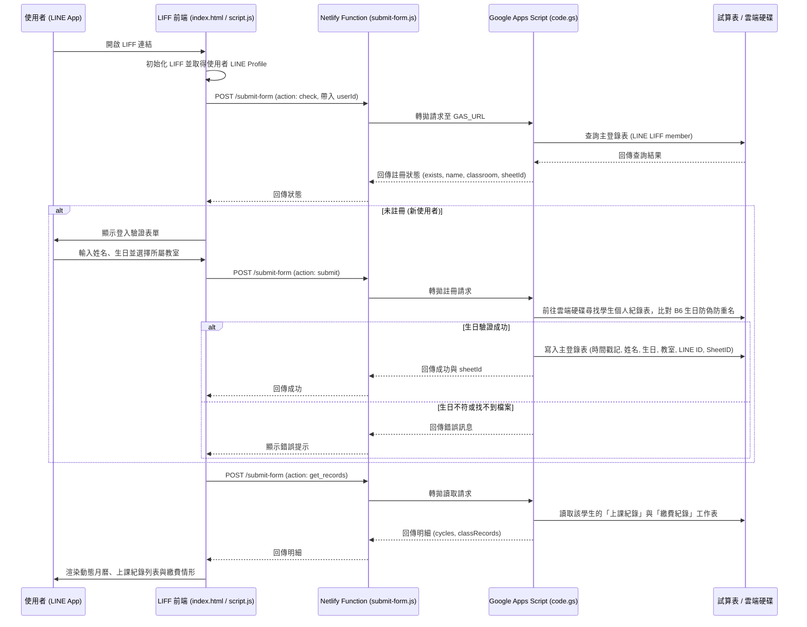

# 學習繳費紀錄查詢系統 (LIFF Form)

本專案是一個基於 **LINE LIFF (LINE Front-end Framework)**、**Netlify Serverless Functions** 與 **Google Apps Script (GAS)** 打造的**學習與繳費紀錄查詢系統**。
學生與家長可直接在 LINE 官方帳號對話視窗內開啟系統，進行身分驗證並快速查詢歷次上課紀錄、未來預約課程以及每期的繳費明細。

---

## 🏗️ 系統架構



---

## 📁 目錄結構

```text
.
├── GAS/
│   └── code.gs                     # Google Apps Script 核心邏輯 (容器綁定於試算表)
├── netlify/
│   └── functions/
│       └── submit-form.js          # Netlify Serverless Function (安全反向代理與 CORS 處理)
├── index.html                      # LIFF 前端頁面結構與響應式樣式
├── script.js                       # 前端核心邏輯 (LIFF SDK、動態月曆渲染、資料呈現)
├── package.json                    # 專案相依設定檔 (含 @google/clasp)
├── package-lock.json               # 相依套件版本鎖定檔
├── .gitignore                      # Git 忽略檔案設定 (忽略 node_modules 等)
└── README.md                       # 專案說明文件
```

---

## ⚙️ 各模組核心功能說明

### 1. 前端網頁 (Client-side)
* **`index.html`**
  * 響應式手機體驗設計，內嵌 LINE LIFF SDK (`https://static.line-scdn.net/liff/edge/2/sdk.js`)。
  * 提供「系統登入」表單（姓名、生日、教室下拉選單：Im未來 / Jeff Coding）。
  * 登入後展示「計費週期選擇器」、動態「上課紀錄月曆與表格」及「繳費情形明細」。
  * 支援快速「返回聊天室」按鈕。
* **`script.js`**
  * **LIFF 初始化與身分確認**：進入時自動透過 LINE Profile 檢查是否已註冊。
  * **主題切換**：依學生所屬教室動態切換色彩風格（Im未來為綠色主題、Jeff Coding 為藍色主題 `blue-theme`）。
  * **預約上課視覺效果**：
    * 判定標準：上課日期嚴格大於當天（`> 今天 23:59:59`）判定為「預約上課」。
    * 月曆標記：已上課日期顯示為實心圓底色；預約上課顯示為主題色「空心圓圈」（日期數字維持與一般日期相同之深灰字）。
    * 列表顯示：預約課程在下方列表中整列以淺灰色（`#9e9e9e`）文字顯示。
    * 繳費金額淡化：當前選擇的週期若含有預約課程，其「應繳總計」與「本期結餘」數值自動淡化為淺色（負值結餘顯示為淺紅色 `#ef9a9a`）。

### 2. 後端伺服器代理 (Netlify Functions)
* **`netlify/functions/submit-form.js`**
  * 部署在 Netlify 上的 Serverless API 端點 (`/.netlify/functions/submit-form`)。
  * **保護與代理**：讀取 Netlify 環境變數 `GAS_URL`，將前端請求轉發至 Google Apps Script Web App，免除在前端暴露後端 Google 試算表與指令碼網址，同時解決跨網域資源共用 (CORS) 限制。

### 3. 資料庫與商業邏輯 (Google Apps Script)
* **`GAS/code.gs`**
  * 屬於**容器綁定型指令碼（Container-bound Script）**，內嵌於主試算表 **`LINE LIFF member`**。
  * 支援四種操作 (`action`)：
    1. **`check`**：比對主登錄表，檢查使用者的 LINE `userId` 是否已綁定，回傳學生姓名、教室與個人試算表 ID (`sheetId`)。
    2. **`submit`**：註冊並驗證學生身分。依姓名與教室至雲端硬碟特定目錄搜尋學生個人的上課紀錄試算表，比對「基本資料」工作表中的 `B6` 生日欄位，確認正確無誤後將該學生的資料及 `sheetId` 寫入主登錄表。
    3. **`get_records`**：直接由 `sheetId` 開啟學生個人試算表，讀取並彙整「上課紀錄」（內容、日期時間）與「繳費紀錄」（各週期起訖、應繳總計、結餘、實收與收費日）。
    4. **`get_students`**：比對 `ADMIN_USER_ID` 後取得學生名冊；只有空快取或 `refresh: true` 才掃描雲端硬碟。

### 管理員設定與操作

1. 在 GAS「專案設定 → 指令碼屬性」新增 `ADMIN_USER_ID`，填入管理員的 LINE userId（登入時可在瀏覽器 Console 的 `LINE userId:` 訊息取得）。請勿把此設定值提交至版本庫。
2. 確認主試算表的登錄分頁名稱為 `LINE LIFF member`（或預設之第一分頁），執行 GAS 的帳號可讀取教室 I、J 資料夾並編輯主試算表。
3. 管理員登入後會直接進入學生選單介面：
   - 頂部直接呈現學生人數統計與篩選器（全部：琥珀色系、Im未來：綠色系、Jeff Coding：藍色系）。
   - 學生卡片直觀標示：Jeff Coding 學生為藍底樣式，Im未來 學生為綠色系字型。
   - 點選學生可檢視月曆、上課及繳費紀錄，並套用該教室主題；頂部提供「⬅️ 返回學生選單」按鈕，且保留原搜尋與篩選狀態。
4. 首次取得名冊會自動建立 `學生名冊快取` 分頁，欄位為「學生姓名、所屬教室、檔案ID、更新時間」：
   - 掃描先採用已註冊學生的精確檔案對照，再合併教室 I（含子資料夾）、教室 J 的 Google 試算表。
   - **嚴格排除目錄**：排除「`紀錄表-Im\試聽紀錄`」與「`紀錄表-Im\Template`」目錄及其所有子檔案。
   - **排序規則**：Im未來 (`I`) 學生在前、Jeff Coding (`J`) 學生在後；同教室內依照檔名或資料夾前綴編號中的純數字（支援純數字與英數前綴如 `J01, J03, J04, J05`）由小到大排序；無編號者排最後；相同編號依中文姓名筆劃排序。
5. 快取永不自動過期；新增、移動或更名學生檔案後，請按「🔄 重新整理名單」。掃描成功才覆寫舊資料，掃描失敗時保留原快取並顯示重試訊息。

權限比對沿用既有前端傳入的 LINE userId，並未新增 LINE token 伺服器驗證；既有 `get_records` 的存取模型也維持原狀。

本機回歸測試：執行 `node --test tests/admin.test.cjs`，以模擬 GAS／DOM 驗證權限、掃描、快取及管理員與一般學生流程；不會連線或修改正式 Google 資料。

---

## 🔑 環境變數與關鍵配置
 
- **Netlify 專案（Site）名稱**：**`liff-test-page`**
- **Netlify 站點網址**：**https://liff-test-page.netlify.app**
- **Netlify 後台管理連結**：https://app.netlify.com/sites/liff-test-page
- **關聯的 GitHub 倉庫**：[JeffCodingMentor/liff-form](https://github.com/JeffCodingMentor/liff-form) (`main` 分支自動觸發部署)
- **關聯的 LINE LIFF ID**：`2009406277-fAYDHQN4`（其 LINE Developers Console 的 Endpoint URL 正是導向至 `https://liff-test-page.netlify.app/`）
- **最新 GAS_URL（固定 Web App 部署網址）**：
  `https://script.google.com/macros/s/AKfycbwMpcyo_8KVlHKUdHkSutk4KMjm-Y-IIy-jgLJoCJDEv7wrdsiZv2uqNHFvik1qXIoPNQ/exec`
  （Deployment ID: `AKfycbwMpcyo_8KVlHKUdHkSutk4KMjm-Y-IIy-jgLJoCJDEv7wrdsiZv2uqNHFvik1qXIoPNQ`）

| 配置項目 | 檔案位置 / 環境 | 說明 |
| :--- | :--- | :--- |
| `liffId` | `script.js` | LINE LIFF App ID (`2009406277-fAYDHQN4`) |
| `oaId` | `script.js` | LINE 官方帳號 ID (`@838phhvg`) |
| Netlify 專案名稱 | Netlify Dashboard | `liff-test-page` |
| Netlify 網站網址 | Netlify / LINE Endpoint | `https://liff-test-page.netlify.app` |
| `GAS_URL` | Netlify Console 環境變數 | Google Apps Script 部署之 Web App 執行網址 (固定 Deployment ID) |
| 主登錄表 | Google 雲端硬碟 | 試算表 `LINE LIFF member` (ID: `1uufBWRzlxPNJKZbjo4yE-TJD3LWqxHIJj1zQg5__xq4`) |
| 教室目錄 | `GAS/code.gs` | 教室 I（Im未來）目錄 ID: `1A4SOGVwZCG77rA8lXfGaT1pHXoeJ7n8z`<br>教室 J（Jeff Coding）目錄 ID: `1mYCVAVWSjn_b0T1yOnF96KakJ5jeQJqU` |
| GAS 專案 ID | `.clasp.json` | `1_zsFdWKyMpXbFPtxPoXegKgX2mHhUc3ijwx4UiYjJmBh7PYZSOsIX00V` |

---

## 🚀 部署與維護方式

1. **前端與 Netlify Functions 部署**
   * 本專案已連動 GitHub 倉庫 (`main` 分支)。
   * 本地修改後，只需執行 Git 提交並推送至 GitHub，Netlify 即會自動觸發 CI/CD 建置與發布：
     ```bash
     git add .
     git commit -m "更新說明"
     git push origin main
     ```
2. **Google Apps Script 部署（覆蓋現有 Deployment ID，保持網址固定）**
   * 本專案統一使用覆蓋更新既有 Deployment ID 的方式部署，**毋須頻繁更換 Web App 網址**，Netlify 亦不需重複設定環境變數：
     ```powershell
     # 1. 強制推送最新程式碼至 GAS 專案
     npx @google/clasp push -f

     # 2. 更新既有的正式部署版本（網址維持不變）
     npx @google/clasp deploy -i AKfycbwMpcyo_8KVlHKUdHkSutk4KMjm-Y-IIy-jgLJoCJDEv7wrdsiZv2uqNHFvik1qXIoPNQ --description "更新說明"
     ```
